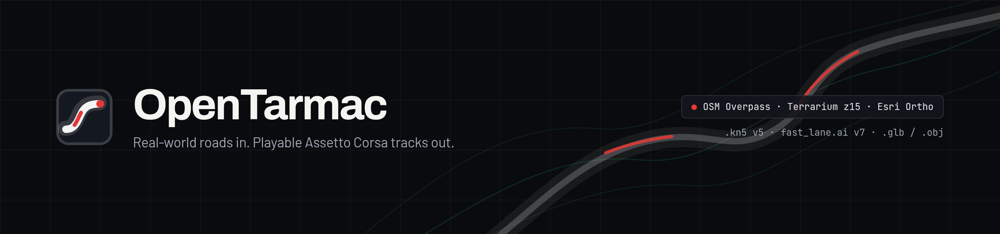
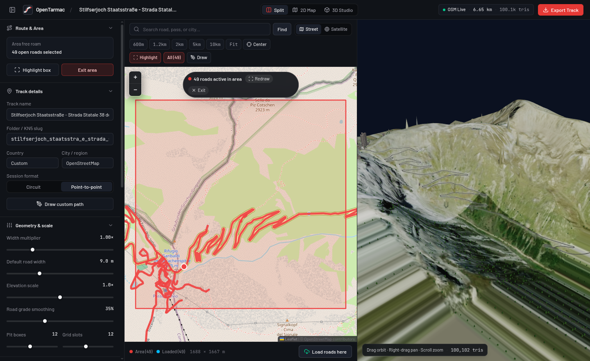
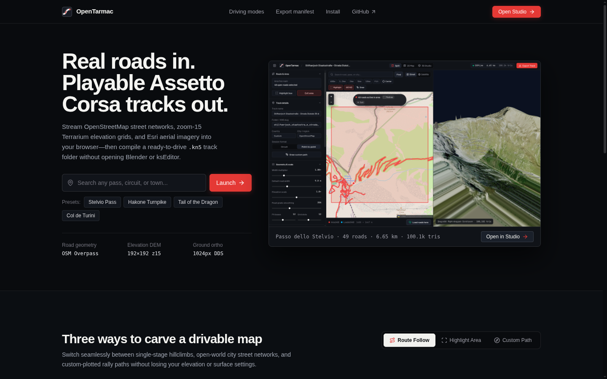

<p align="center">
  
</p>

Turn your favorite mountain pass, coastal highway, or city street network into a playable **Assetto Corsa** mod directly in your browser—with zero Blender or `ksEditor` setup required.

**OpenTarmac** streams live OpenStreetMap road networks, zoom-15 AWS Terrarium elevation grids, and Esri World Imagery into a split 2D/3D WebGL studio, then compiles native Kunos `.kn5`, `.ai`, `.dds`, and `.ini` files into a drop-in `.zip` track package.

---

## Screenshots

### 2D Map & 3D WebGL Studio

Select any road to trace a stage, drag a bounding box for open-world free roam, or drop custom waypoints—while inspecting real elevation relief, ortho terrain, buildings, canopy trees, and AC spawn/timing dummies in real time.

<p align="center">
  
</p>

*Passo dello Stelvio (`49` open roads highlighted, `6.65 km`, `100,102` triangles) rendered in Split View.*

### Landing & Quick Location Launcher

Jump straight to any pass, circuit, or town via Nominatim search or preset shortcuts.

<p align="center">
  
</p>

---

## How roads become drivable Assetto Corsa tracks

```
[OpenStreetMap Roads] ──┐
[Terrarium DEM Tiles] ──┼──▶ [3D Mesh & AI Splines] ──▶ [Native .kn5 + .zip Track]
[Esri Aerial Imagery] ──┘
```

- **Zoom-15 elevation accuracy:** AWS/Mapzen Terrarium RGB heightmaps are decoded onto a `192×192` bilinear grid with configurable vertical smoothing (`roadSmoothing`) and scale (`elevationScale`) so hairpins and climbs hold authentic grade without DEM staircase noise.
- **Orthophoto ground & canopy detection:** Esri World Imagery tiles stitch into a `1024×1024` ground texture (`1GRASS_terrain`). Neighborhood luminance and green-excess filtering detect real roadside tree canopies to plant low-poly 3D trees off-road without blocking buildings or tarmac.
- **Automatic road surface matching:** Centerline pixel sampling estimates authentic asphalt or concrete tint directly from aerial imagery while ignoring lane markings and tree shadows.
- **Native AC physics & spawn nodes:** Roads emit `1ROAD_*` surfaces, kerbs emit `1KERB_main`, barriers emit `1WALL_guardrail`, and transforms are placed for `AC_START_*`, `AC_PIT_*`, `AC_HOTLAP_START_0`, `AC_TIME_0..2_L/R`, and point-to-point `AC_AB_START_L/R` & `AC_AB_FINISH_L/R` gates.

---

## Three ways to carve out a map

| Mode | Best For | How It Works |
| --- | --- | --- |
| **Route Follow** | Touge runs & rally stages | Click any street on the map and trace up to `25 km` along connected OSM ways. Inspect junctions and swap forks with one click. |
| **Highlight Area** | Free-roam towns & canyon loops | Drag a bounding box or select all loaded roads at once. Batches secondary roads into chunked `1ROAD_network` meshes and omits per-road barriers (`freeRoam`) so intersections stay open. |
| **Custom Path** | Fantasy circuits & shortcuts | Place waypoints anywhere over real Terrarium elevation contours; resampled via centripetal Catmull-Rom splines. |

---

## Running OpenTarmac locally

No backend server or Python toolchain is required. Clone the repo and start Vite with Node.js `18+`:

```bash
git clone https://github.com/bomberrie/OpenTarmac.git
cd OpenTarmac
npm install
npm run dev
```

Open `http://localhost:5173` in your browser, search for any region or click **Open Studio**, hit **Load roads here** after panning, and click **Export Track** once the 3D layout looks right.

### Build & test suite

Vitest covers WGS84 local tangent-plane projection, Terrarium decoding, Overpass query/JSON parsing, route tracing, Catmull-Rom spline resampling, `.kn5` binary EOF & 65k-vertex splitting, `fast_lane.ai` v7 serialization, `.glb`/`.obj` export, and `.zip` packaging:

```bash
npm run build
npm test
```

---

## Installing exported tracks in Assetto Corsa

1. Download `<slug>.zip` from the **Export Track** modal.
2. Extract the `<slug>` folder into `assettocorsa\content\tracks\` so `<slug>.kn5` sits directly beside `models.ini`.
3. Launch **Content Manager** or Assetto Corsa and select **Practice**, **Hotlap**, or **Track Day**.

> [!TIP]
> Large multi-kilometer street networks load fastest in Content Manager's **Track Day** or **Practice** mode. If you want open intersections without trackside walls, keep **Free roam (open roads)** enabled before exporting.

---

## Inside the exported `<slug>.zip`

Every export is compiled in pure TypeScript under `content/tracks/<slug>/`:

- **`<slug>.kn5`** — Kunos v5 (`sc6969`) binary scene with embedded 32-bit BGRA (`A8R8G8B8`) `.dds` textures, `ksPerPixel` materials, automatic `< 65,000`-vertex mesh splitting, and AC transform dummies.
- **`ai/fast_lane.ai` & `ai/pit_lane.ai`** — Version 7 binary splines (`AiPoint` + 18-float `AiPointExtra`) carrying track widths, arc lengths, and forward vectors.
- **`data/*.ini`** — `surfaces.ini` (`ROAD`, `KERB`, `GRASS`, `WALL`, `GRAVEL`), `lighting.ini`, `cameras.ini`, `sections.ini`, and calibrated `map.ini`.
- **`ui/*` & `map.png`** — Live WebGL `preview.png`, route vector `outline.png`, HUD minimap `map.png`, and `ui_track.json` telemetry.
- **`source/<slug>.glb` & `<slug>.obj`** — Ready for optional further detailing in Blender or `ksEditor`.

---

## Built with

- **Frontend:** React `19`, TypeScript `5.8`, Tailwind CSS `v4`, Lucide icons
- **Mapping & 3D:** Leaflet (`OpenStreetMap` + `Esri World Imagery`) & Three.js WebGL
- **Packaging:** Pure TypeScript `.kn5` / `.dds` / `.ai` / `.png` / `.glb` encoders & JSZip

---

## License

Source-available for private local use only under [LICENSE](LICENSE). You can clone and run OpenTarmac on your own machine for personal track building, though re-uploading, hosting on another website, or redistributing the codebase is not permitted.
